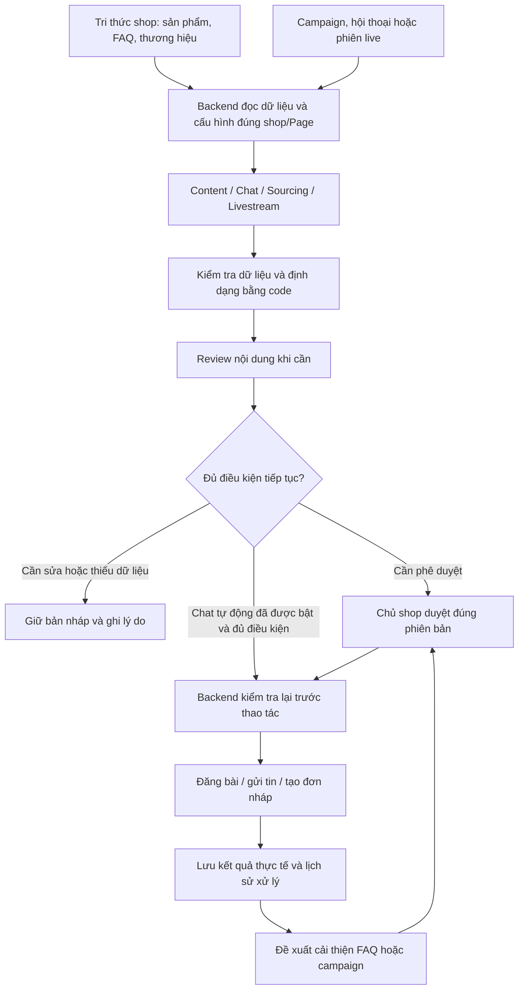

# Định hướng và kế hoạch prototype Tendly

Kế hoạch chi tiết chỉnh sửa Marketing theo brief chiến dịch: [marketing-redesign-plan.md](marketing-redesign-plan.md).

Các kế hoạch theo vai trò: [Customer Care / AI Chat](customer-care-redesign-plan.md), [AI Review](review-redesign-plan.md), [Livestream](livestream-redesign-plan.md), [Smart Sourcing](smart-sourcing-redesign-plan.md). Content thuộc kế hoạch Marketing; các plan này cập nhật chi tiết theo các thảo luận tiếp theo.

Ngày lập: 05/11/2026. Cơ sở: `Góp ý cho tendly.txt` và đối chiếu source hiện tại. Đây là đề xuất để chốt hướng; chưa triển khai các thay đổi mô tả bên dưới.

## 1. Hướng đi đề xuất

**Tendly là hệ thống phối hợp các vai trò AI để hỗ trợ vận hành một shop online: dùng chung tri thức sản phẩm, nối marketing với tư vấn và hỗ trợ bán hàng, có phê duyệt và xử lý ngoại lệ.**

Mục tiêu prototype là chứng minh một quy trình chạy xuyên suốt, giải thích được mỗi bước dùng dữ liệu gì, tạo ra kết quả gì và tại sao được tiếp tục hoặc phải dừng. Định hướng dài hạn là shop cần ít thao tác thủ công; phạm vi lần này dừng ở hỗ trợ tư vấn và đơn nháp, chưa cam kết shop chỉ cần người đóng hàng.

Giả định để giữ phạm vi:

- Một shop thời trang/phụ kiện, một Fanpage, khoảng 10 sản phẩm; tận dụng dữ liệu và luồng có sẵn.
- Một campaign bảy ngày, ba trụ cột nội dung, khoảng sáu bài để trình diễn cách lập kế hoạch và duyệt.
- Facebook/Messenger là kênh tích hợp ưu tiên. TikTok dùng bản nội dung phù hợp nền tảng để xem trước/xuất thủ công.
- Năm vai trò AI đều có mô tả và prototype; ưu tiên triển khai sâu Content, Chat và Review.
- Chưa có thông tin về deadline hoặc số người thực hiện; chia theo mốc nghiệm thu, chưa ấn định số ngày.

Ba câu hỏi prototype phải trả lời được:

1. Cùng một sản phẩm, Content, Chat và Livestream có sử dụng nhất quán giá, đặc điểm và chính sách không?
2. Chủ shop có kiểm soát được những gì AI được làm, những gì phải duyệt và từng hội thoại đang ở chế độ nào không?
3. Khi dữ liệu thiếu, nội dung sai hoặc provider lỗi, hệ thống có dừng đúng chỗ và giữ được lịch sử xử lý không?

## 2. Nền đang có và khoảng trống

Các nhận xét dưới đây dựa trên source, không xác nhận provider đang hoạt động hoặc đã gửi/đăng thành công.

| Phần | Bằng chứng hiện tại | Hướng tận dụng |
| --- | --- | --- |
| Tri thức AI | `lib/types/admin.ts`, `aiKnowledge.ts`, `mockDb.ts`: có sản phẩm/FAQ, nhiều cấu hình lưu trên trình duyệt | Bổ sung tri thức sản phẩm và đưa dữ liệu cần dùng chung về server |
| Cấu hình AI | `AiConfigShell.tsx`: ba tab sản phẩm, FAQ, email | Sắp lại theo tri thức chung, vai trò AI và gán kênh; không làm một dashboard mới tách biệt |
| Hội thoại | `messengerAi.ts`: cấu hình theo Page, ngữ cảnh, công việc AI, kiểm tra trước tự gửi và trạng thái cần duyệt | Thêm profile Chat và chế độ từng hội thoại vào chính luồng này |
| Nhãn khách | `lib/types/inbox.ts`: nhãn cảm xúc/ưu tiên; `marketingInsights.ts`: nhận diện sản phẩm và phàn nàn | Mở rộng sang nhãn nhu cầu mua hàng có nguồn và thời điểm |
| Marketing | `aiPost.ts`: tạo nội dung theo kênh; `postsPostgres.ts`: lưu bài; trạng thái bài hiện là `draft/published` | Bổ sung campaign, dàn ý, phê duyệt và kế hoạch đăng quanh luồng bài sẵn có |
| Livestream | `lib/services/live/`, `docs/livestream-api.md`: gom câu hỏi, phản hồi, đơn nháp, giữ tồn kho | Dùng làm nhánh hỗ trợ bán hàng, thống nhất nguồn tri thức và cấu hình |
| Sourcing | Backend Apify có lưu tiến trình/kết quả; `SmartSourcing.tsx` vẫn là demo, chưa nối backend | Prototype có bằng chứng và trạng thái dữ liệu; không làm lại bộ thu thập |
| Tài khoản/phạm vi | `appSecurity.ts`: xác thực server, bảo vệ dữ liệu và giới hạn nghiệp vụ vào Page/demo owner | Giữ giới hạn một shop thật; chưa mở quyền nhiều shop chỉ vì có màn hình chọn Page |

Điểm thiếu lớn nhất là sự liên kết: nguồn tri thức chưa thống nhất hoàn toàn, marketing chưa có quy trình campaign, cấu hình AI chưa thể hiện rõ vai trò và mức tự động hóa.

## 3. Kiến trúc vừa đủ cho prototype

Giữ Next.js, các service nghiệp vụ hiện có và PostgreSQL. Năm vai trò có thể dùng chung hàm gọi Gemini, mỗi vai trò nhận ngữ cảnh, chỉ dẫn và schema đầu ra phù hợp. Chưa cần năm model, năm dịch vụ, framework agent, microservices hoặc vector database.



Sourcing chỉ tạo đề xuất để shop xem xét. Kết quả tìm nguồn không tự biến thành sản phẩm đang bán. Vòng phản hồi cuối tạo một yêu cầu duyệt mới, không tự sửa FAQ hoặc tự đăng nội dung tiếp theo.

Mỗi lượt xử lý nên lưu tối thiểu: vai trò, đối tượng liên quan, phiên bản cấu hình/tri thức đã dùng, kết quả, trạng thái, lỗi và thời gian. Khi có duyệt, ghi người duyệt và phiên bản được duyệt. Mở rộng lịch sử ở service đang sở hữu công việc; chưa dựng một workflow engine tổng quát.

## 4. Chuẩn hóa tri thức trước khi mở rộng AI

### 4.1. Hồ sơ sản phẩm

Giữ SKU, tên, giá, tồn kho, chất liệu, màu và size đang có. Bổ sung các trường phục vụ trực tiếp cho tư vấn và viết bài:

| Nhóm | Nội dung tối thiểu | Công dụng |
| --- | --- | --- |
| Mô tả | Mô tả ngắn, tính năng, lợi ích, USP do shop cung cấp | Viết bài và tư vấn có căn cứ |
| Nhu cầu | Khách phù hợp, tình huống sử dụng, keyword/từ đồng nghĩa | Nhận diện sản phẩm khách đang hỏi |
| Liên quan | ID sản phẩm liên quan, lý do gợi ý | Gợi ý thay thế khi phù hợp và khách cần |
| Giới hạn | Những điều chưa biết hoặc không được cam kết | Tránh tự hứa hiệu quả, chất lượng, giao hàng |
| Nguồn | Nhập tay/đồng bộ, thời điểm cập nhật | Biết độ mới và xuất xứ thông tin |

Dùng trường thông tin chung cho ngành đã chọn; chưa làm bộ thiết kế schema riêng cho mọi ngành. Tồn kho tổng hiện tại không chứng minh từng size/màu còn hàng. Nếu chưa có tồn kho theo biến thể, câu trả lời và đơn nháp phải thể hiện giới hạn này.

### 4.2. Tri thức shop dùng chung

Gồm hồ sơ thương hiệu, giọng văn, FAQ/chính sách, sản phẩm và ưu đãi đã được shop xác nhận với thời gian hiệu lực. Không coi ghi chú AI tự tạo hoặc mẫu email là ưu đãi thật.

Đích triển khai: backend đọc bản tri thức đã lưu của shop/Page; trình duyệt gửi yêu cầu và ID, không trở thành nguồn quyết định giá, tồn kho hay quyền hành động. Trước tiên làm cho một shop đang được cho phép truy cập.

Khi chuyển dữ liệu trình duyệt về server, cho xem trước và xác nhận nhập, giữ bản cũ đến khi lưu thành công, báo xung đột SKU và không ghi đè dữ liệu đồng bộ âm thầm. Khi ngừng dùng bản sao tri thức trong cấu hình Messenger, phải cập nhật cả luồng tự trả lời, không chỉ màn hình thử AI.

**Nghiệm thu:** sửa một thông tin sản phẩm/FAQ, các lượt tạo nội dung và tư vấn mới cùng dùng bản đã sửa. Bản nháp cũ vẫn truy được phiên bản nguồn; trước khi gửi phải kiểm tra lại những dữ kiện có thể đã thay đổi.

## 5. Năm vai trò AI, trách nhiệm riêng

| Vai trò | Mục tiêu | Input | Output chính | Giới hạn quyền |
| --- | --- | --- | --- | --- |
| Content | Từ mục tiêu campaign đến dàn ý và bài theo kênh | Tri thức shop, sản phẩm, tệp khách, trụ cột, brief đã duyệt | Kế hoạch, dàn ý, bản nội dung từng kênh | Không tự duyệt/đăng hoặc đặt ra ưu đãi |
| Chat | Hiểu nhu cầu, tư vấn, thu thập thông tin cần thiết | Lịch sử hội thoại, sản phẩm/chính sách hiện hành, mode | Câu trả lời, nhãn nhu cầu, thông tin còn thiếu, đề xuất bước tiếp | Không tự xác nhận thanh toán, hoàn tiền, đơn hoàn tất |
| Review | Kiểm tra nội dung so với brief và dữ liệu shop | Bản nháp, nguồn tri thức, quy tắc kênh | Đạt/cần sửa/chặn; lỗi cụ thể và gợi ý sửa | Không thay quyền duyệt của shop hoặc kiểm tra quyền bằng code |
| Smart Sourcing | Giúp đánh giá sản phẩm và nguồn hàng đáng xem xét | Ngành/từ khóa, dữ liệu thu thập có nguồn | Sản phẩm/nguồn liên quan, link bằng chứng, dữ kiện còn thiếu | Không xác minh chất lượng nhà cung cấp hay tự nhập hàng |
| Livestream | Hỗ trợ shop xử lý nhiều bình luận cùng lúc | Bình luận, sản phẩm đang giới thiệu, tri thức và tồn kho | Nhóm câu hỏi, gợi ý phản hồi, đơn nháp, tổng kết | Dùng lại lõi hiện có; chưa tích hợp mọi nền tảng live |

Mỗi profile có tên, vai trò, mục tiêu, văn phong, nguồn dữ liệu được dùng, input/output mẫu và mức tự động hóa được phép. Quy tắc bắt buộc do backend giữ; ô mô tả mục tiêu không được cho phép bỏ qua quyền, giá hay điều kiện gửi.

Review gồm hai lớp: code kiểm tra cấu trúc, ID, trường giá/tồn kho và điều kiện hành động; AI kiểm tra độ phù hợp, giọng văn và các phát biểu có nguy cơ thiếu căn cứ. AI Review vẫn có thể sai. Không dùng điểm tự tin của model làm điều kiện duy nhất để tự gửi. Chat đơn giản có thể dùng kết quả kiểm tra sẵn trong lượt phân tích; chưa bắt mọi tin đi qua một lượt model thứ hai.

Với tìm nguồn hàng, dùng code để tìm kiếm, chuẩn hóa, bỏ trùng và lọc điều kiện trước. Chỉ dùng AI nếu cần gom tên sản phẩm hoặc giải thích kết quả; không gọi model chỉ để có đủ năm nút AI.

## 6. Gán Fanpage và điều khiển từng hội thoại

Hiểu yêu cầu “mỗi trang một AI tự chọn” là mỗi Fanpage chọn một profile Chat phù hợp thương hiệu. Content, Review và Livestream vẫn là các vai trò khác trong cùng shop, không tranh nhau trả lời inbox.

Prototype màn gán kênh hiển thị: Page, profile Chat, trạng thái bật/tắt, chế độ mặc định và đường dẫn cấu hình liên quan. Một Page thật là đủ cho demo; Page khác nếu cần minh họa phải ghi là mô phỏng. Muốn chạy nhiều Page thật phải hoàn thiện quyền sở hữu Page và chọn token tương ứng trước.

Ba chế độ hội thoại:

- **Thủ công:** không tự phân tích, soạn hay gửi; shop có thể chủ động yêu cầu gợi ý nếu AI của Page đang bật.
- **Gợi ý:** AI phân tích và soạn nháp; người bán gửi.
- **Tự động có điều kiện:** chỉ tự gửi khi đủ dữ liệu và các kiểm tra backend đều đạt; còn lại đưa về cần người xử lý.

Thứ tự kiểm soát: quyền truy cập/bảo vệ app → công tắc AI của Page → mode hội thoại → điều kiện nghiệp vụ và chính sách kênh. Hội thoại không thể bật vượt Page đã tắt. Phải kiểm tra lại ngay trước gửi, kể cả khi model đã tạo xong nội dung. Bật lại không gửi bù công việc cũ một cách tự động.

Giữ các kiểm tra sẵn có về tin mới nhất, hàng chờ cần duyệt, file đính kèm và trạng thái không rõ đã gửi hay chưa. Khi nhân viên nhận xử lý, dừng tự gửi cho hội thoại cho đến khi shop chủ động bật lại. Hiển thị rõ lý do đang bị chặn; `needsHuman` chỉ thành bàn giao thực tế khi có công việc được tạo và người xử lý nhận.

## 7. Luồng trọng tâm: campaign có phê duyệt

### 7.1. Ví dụ xuyên suốt

Shop muốn giới thiệu bộ sưu tập áo đi học trong bảy ngày. Shop chọn sản phẩm, khách mục tiêu, mục tiêu và ưu đãi nếu có. AI đề xuất ba trụ cột: phối đồ, hiểu sản phẩm và giải đáp trước mua. Mỗi trụ cột có đề tài, heading, dàn ý, sản phẩm liên quan, CTA, kênh và dịp đăng.

Flow cần thực hiện:

1. Shop nhập thông tin chung và yêu cầu campaign.
2. AI tạo kế hoạch/trụ cột/heading/dàn ý.
3. Shop sửa và duyệt kế hoạch trước khi tạo bài theo kế hoạch đó.
4. AI tạo bản Facebook, caption/kịch bản TikTok theo cùng ý tưởng và brief đã duyệt.
5. Review kiểm tra; shop sửa và duyệt từng bản nội dung.
6. Bài đủ điều kiện mới được đưa vào kế hoạch đăng hoặc đăng qua kênh đã tích hợp.

Để thể hiện ý “yêu cầu chung” trong góp ý, tách ba lớp: thông tin campaign → quy tắc heading/dàn ý → quy tắc viết bài. Các lớp sau kế thừa bản đã duyệt ở trước, không yêu cầu người dùng nhập lại toàn bộ.

### 7.2. Trạng thái và phiên bản

Kế hoạch: `Nháp → Chờ duyệt → Đã duyệt`, hoặc trả lại cần sửa. Bài: `Nháp → Chờ kiểm tra/duyệt → Đã duyệt → Có lịch → Đã đăng`; thêm trạng thái lỗi hoặc chưa rõ kết quả gửi khi thực sự có thao tác ra provider.

Mỗi lần duyệt gắn với một phiên bản. Sửa bài đã duyệt phải duyệt lại; sửa kế hoạch khiến bài bị ảnh hưởng cần được rà soát. Giá, ưu đãi hết hiệu lực hoặc sản phẩm hết hàng phải được kiểm tra trước đăng, không tin bản nháp cũ vô điều kiện.

Lịch có thể là một lần, gắn với dịp/sự kiện hoặc chuỗi nhiều bài với từng mốc xác định. Bản đầu không cần lịch lặp vô hạn. “Loại nội dung” và “kiểu thời điểm đăng” là hai thuộc tính khác nhau, không xây hai hệ thống lịch.

Lưu lịch và tự động đăng đúng giờ là hai mức hoàn thành khác nhau. Prototype có thể lưu lịch, hiển thị bài đến hạn và cho shop bấm thực thi. Chỉ gọi là tự đăng nền sau khi có runner bền vững, khóa nhận công việc, kiểm tra quyền/phiên bản, chống đăng trùng và kiểm thử khi khởi động lại. Không dùng tab trình duyệt hoặc timer trong request để cam kết đăng đúng giờ.

## 8. Nối marketing với chăm sóc khách và hỗ trợ bán hàng

```text
Campaign/bài đăng hoặc phiên live
    → Khách tương tác
    → Nhận diện nhu cầu và sản phẩm đang hỏi
    → Tư vấn theo tri thức đã xác nhận
    → Đề xuất đơn nháp và hỏi thông tin còn thiếu
    → Shop kiểm tra/xác nhận đơn nháp
    → Đề xuất nội dung hoặc FAQ cho những nhu cầu còn bỏ ngỏ
```

Ngữ cảnh campaign phải gồm đúng sản phẩm/ưu đãi có hiệu lực, không chỉ truyền tên campaign. Chỉ gắn nguồn campaign khi có liên kết hoặc metadata chứng minh; không coi cùng hỏi một sản phẩm là đã xác định được bài tạo chuyển đổi.

Nhãn ngữ cảnh ưu tiên: hỏi giá, quan tâm SKU, đang cân nhắc, thiếu thông tin đặt hàng, cần người xử lý. Mỗi nhãn lưu căn cứ tin nhắn, thời điểm và nguồn AI/thủ công; cho shop sửa. Nhãn cũ có thể hết hiệu lực. “Đã mua” cần trạng thái đơn xác nhận, không suy ra từ câu “chốt”.

Nhãn phải dẫn đến hành động hữu ích: thiếu size thì hỏi lại size; nhiều khách hỏi cách giặt thì đề xuất FAQ/bài hướng dẫn; phàn nàn thì đưa về hàng chờ người xử lý. Không tự nhắn lại mọi khách chỉ vì một nhãn xuất hiện.

Đơn nháp gồm SKU/biến thể đã biết, số lượng, giá kiểm tra bởi server, thông tin liên hệ còn thiếu và nguồn hội thoại/live. Dùng lại logic đơn/giữ tồn kho hiện có khi phù hợp; không đồng nhất giữ hàng với thanh toán. Khi xác nhận, kiểm tra lại giá/tồn và chống tạo trùng từ cùng sự kiện. Bản đầu chưa cần thanh toán, vận chuyển hoặc CRM riêng.

## 9. Độ sâu phù hợp cho các nhánh còn lại

### Livestream

Tái sử dụng luồng gom câu hỏi, sản phẩm đang lên sóng, phản hồi theo nhóm và đơn nháp. Chứng minh cùng một nguồn tri thức được dùng trong Chat và Live. Bắt đầu với mẫu khoảng 30 bình luận: hỏi giá, hỏi size, hỏi mơ hồ, chốt trùng và phàn nàn. Nếu phát lại bình luận ghi sẵn, ghi rõ nguồn là mô phỏng.

Lõi live hiện chốt danh mục khi bắt đầu phiên. Plan triển khai phải nêu rõ phần nào là snapshot và phần nào được phép cập nhật trong phiên, giữ quy tắc flash sale/tồn kho của lõi. Không chỉ đổi giao diện rồi tuyên bố dữ liệu đã đồng bộ.

### Smart Sourcing

Đầu vào ngành/từ khóa → chạy thu thập hoặc nạp bộ dữ liệu ghi sẵn → chuẩn hóa/bỏ trùng → nhận diện sản phẩm → hiển thị bằng chứng và nguồn liên quan. Mỗi kết quả có URL, thời điểm thu thập, số liệu thực có và trường chưa rõ.

Một lần thu thập chỉ cho phép nói “nổi bật trong mẫu dữ liệu”. Muốn nói “đang tăng” phải có các mốc so sánh hợp lý. Không dùng tương tác để suy ra doanh số; nhà cung cấp là đầu mối chưa được xác minh. Kết quả được chọn chỉ thành bản nháp sản phẩm sau khi shop bổ sung giá bán/tồn kho và xác nhận.

Nối UI vào backend Apify là nhánh riêng sau khi chốt Actor/input/output và kiểm tra một lượt thật. Có thể trình bày bộ dữ liệu ghi sẵn nếu provider không sẵn sàng; tuyệt đối không đổi nhãn mẫu thành thu thập trực tiếp.

### Seeding và chăm sóc lại

Prototype nhỏ: từ keyword → gợi ý chủ đề/nơi tiếp cận phù hợp → soạn nội dung phù hợp ngữ cảnh → shop duyệt/xuất nội dung. Chỉ gửi tự động khi có kênh, quyền và đối tượng nhận phù hợp được xác minh. Chưa làm bot tài khoản cá nhân, tìm tệp rồi nhắn hàng loạt hoặc một bộ tự động đăng mọi nhóm.

Đổi yêu cầu “lách luật 24h” thành “xác định cách liên hệ tiếp theo được nền tảng cho phép”: kiểm tra loại kênh, loại tin, lần tương tác, quyền, sự đồng ý và mẫu tin nếu áp dụng; không đủ điều kiện thì giữ bản nháp và giải thích lý do. Không mặc định đổi sang email/SMS khi chưa có thông tin và sự đồng ý phù hợp.

Đã đối chiếu ngày 05/11/2026: [Zalo OA — Tin Tư vấn](https://oa.zalo.me/home/documents/guides/tin-tu-van) mô tả gửi qua OA OpenAPI trong bảy ngày kể từ tương tác cuối, khung miễn phí 48 giờ và các điều kiện tương tác/không chặn OA. Vì vậy không áp chung mốc 24 giờ trong góp ý cho mọi nền tảng. Trang chính sách Meta bị giới hạn truy cập khi tra cứu lần này; điều kiện Meta cụ thể cần đối chiếu lại trước khi viết connector. Không coi một giá trị thời gian trong code hiện tại là bằng chứng chính sách luôn còn đúng.

## 10. Lộ trình theo mốc nghiệm thu

| Mốc | Công việc | Kết quả cần có để qua mốc |
| --- | --- | --- |
| 1. Chốt kịch bản và hợp đồng | Chọn shop/ngành, chuẩn bị sản phẩm, campaign mẫu và ca hội thoại; mô tả năm vai trò, luồng và mức thật/mô phỏng | Một kịch bản demo xuyên suốt, input/output mẫu và phạm vi được chốt; chưa cần thêm tích hợp |
| 2. Tri thức và quyền điều khiển | Bổ sung sản phẩm/FAQ/thương hiệu; lưu nguồn dùng chung trên server; profile Chat, gán Page và mode hội thoại | Sửa một nơi được dùng ở lượt xử lý mới; Page tắt hoặc hội thoại thủ công thì công việc nền không tự gửi |
| 3. Campaign và Review | Kế hoạch → duyệt → bài theo kênh → kiểm tra → duyệt → kế hoạch đăng | Có sáu bài liên kết kế hoạch; bài chưa duyệt không được thực thi; sửa sau duyệt buộc duyệt lại |
| 4. Tư vấn đến đơn nháp | Nhãn có căn cứ, hỏi lại thông tin thiếu, liên kết ngữ cảnh campaign khi có, tạo/xác nhận đơn nháp | Khách hỏi mơ hồ không bị chốt sai sản phẩm; sự kiện trùng không tạo thêm đơn; thiếu dữ liệu chuyển sang cần xử lý |
| 5. Hoàn thiện trình diễn | Dùng lại Live; prototype Sourcing/seeding; nhật ký, đo chất lượng, phát lại demo | Chạy được cả luồng thuận và các ca lỗi; phân biệt rõ dữ liệu ghi sẵn, xử lý thật và kết quả provider thật |

Ưu tiên bảo vệ khi thiếu thời gian: tri thức dùng chung → campaign có duyệt → Chat có kiểm soát → một đường đến đơn nháp → tái sử dụng Live → Sourcing/seeding. Năm vai trò có thể xuất hiện trong prototype từ mốc 1, nhưng không đòi năm nhánh backend hoàn chỉnh cùng lúc.

Nếu cần cắt: giữ một kênh gửi thật, dùng thao tác thực thi thủ công cho bài đến hạn, dùng dữ liệu ghi sẵn cho Sourcing và nguồn bình luận demo. Giữ nguyên quyền duyệt, validation, chống trùng và xử lý lỗi trong phần đã tuyên bố là chạy thật.

## 11. Những màn hình cần thể hiện

Tận dụng route/component đang có, chỉ thêm phần cần cho luồng:

| Bề mặt | Điều người xem cần hiểu |
| --- | --- |
| Cấu hình AI | Tri thức chung; năm vai trò và input/output; profile; Page được gán; chế độ mặc định |
| Sản phẩm | Mô tả/USP/keyword/sản phẩm liên quan; nguồn và độ mới dữ liệu |
| Marketing | Brief, trụ cột, dàn ý, duyệt, bài từng kênh, lịch và trạng thái thực thi |
| Hội thoại | Nhu cầu/SKU đang hỏi, mode, căn cứ gợi ý, lý do cần người xử lý, đơn nháp |
| Livestream | Tái sử dụng cockpit; thể hiện nguồn bình luận và ngữ cảnh sản phẩm |
| Smart Sourcing | Nguồn bằng chứng, thời điểm thu thập và dữ liệu còn thiếu |
| Chi tiết một công việc | Dữ liệu/phiên bản đã dùng, kiểm tra, người duyệt, kết quả hoặc lỗi |

Nhật ký có thể nằm ngay trong chi tiết bài/hội thoại/phiên live; chưa cần trang giám sát riêng. Đây là yêu cầu cho prototype, chưa phải thiết kế giao diện được triển khai.

## 12. Kịch bản trình bày khoảng 8–10 phút

1. **Thiết lập:** mở một hồ sơ sản phẩm có USP, chính sách và dữ liệu chưa rõ; chỉ ra năm vai trò dùng dữ liệu nào.
2. **Marketing:** tạo campaign, sửa một heading, duyệt kế hoạch rồi tạo hai bản theo kênh. Cho Review phát hiện một câu cam kết không có căn cứ và shop sửa lại.
3. **Kiểm soát:** thử đưa bài chưa duyệt vào bước thực thi, hệ thống chặn. Duyệt đúng phiên bản và đưa vào lịch; nói rõ lịch này được thực thi thủ công hay có runner.
4. **Tư vấn:** khách hỏi sản phẩm, AI dùng giá/FAQ đúng nguồn; bật chế độ thủ công cho hội thoại rồi cho thấy tự gửi đã dừng.
5. **Bán hàng:** khách cung cấp thông tin; hệ thống đề xuất đơn nháp, shop xác nhận. Phát lại cùng sự kiện để chứng minh không tạo thêm đơn.
6. **Mở rộng:** cho xem một nhóm câu hỏi live và một kết quả sourcing có URL; gắn nhãn rõ nguồn phát lại hoặc dữ liệu mẫu.
7. **Vòng phản hồi:** nhiều câu hỏi lặp tạo đề xuất FAQ hoặc ý tưởng campaign mới để shop duyệt.

Chuẩn bị một kịch bản ghi sẵn để phát lại khi provider lỗi, tách rõ phản hồi AI ghi sẵn với AI gọi tại chỗ. Khi lỗi thật, giao diện phải hiện lỗi/đang chờ thay vì kết quả thành công giả.

## 13. Kiểm chứng và tiêu chí hoàn thành

Chuẩn bị một bộ nhỏ khoảng 20–30 tình huống có đáp án/quyết định kỳ vọng, bao gồm cả các ca khó bên dưới. Chấm chất lượng bằng nguồn sản phẩm/FAQ và người đọc, không chỉ cho model tự chấm.

| Ca kiểm tra bắt buộc | Kết quả kỳ vọng |
| --- | --- |
| Hai sản phẩm có tên gần nhau hoặc khách thiếu size | Hỏi lại, không tự chọn sai |
| Sản phẩm hết hàng hoặc chưa rõ tồn theo biến thể | Không hứa còn đúng size/màu |
| FAQ thiếu phí ship/đổi trả | Báo chưa xác nhận và tạo việc cần xử lý |
| Ưu đãi hết hạn hoặc giá đổi sau khi tạo nháp | Kiểm tra lại, không gửi bản cũ như dữ kiện hiện tại |
| Bài chưa duyệt hoặc sửa sau khi duyệt | Không được thực thi bằng phê duyệt cũ |
| Page tắt AI, mode hội thoại thủ công, hoặc nhân viên nhận xử lý khi AI đang chạy | Kiểm tra lần cuối và dừng tự gửi |
| Webhook/bình luận lặp | Không gửi hoặc tạo đơn trùng |
| Provider timeout khi có thể đã nhận yêu cầu | Giữ trạng thái chưa rõ; không tự gửi/đăng lại mù quáng |
| Hết điều kiện gửi của kênh | Không gửi; hiển thị lý do và lựa chọn hợp lệ nếu có |
| Nội dung yêu cầu AI bỏ quy tắc/đổi giá/lấy dữ liệu khác | Không thay quyền hoặc dữ liệu nghiệp vụ |
| Tài khoản mới chưa được gán Page | Vẫn không được truy cập dữ liệu demo/thật |

Các ca về quyền, duyệt, chống trùng và dữ kiện sai không được có lỗi trong bộ nghiệm thu. Điều này chỉ chứng minh bộ ca đã thử, không chứng minh AI luôn đúng ngoài thực tế.

Đo thêm thời gian chuẩn bị campaign, số lần chỉnh sửa trước duyệt, tỷ lệ câu trả lời bám dữ liệu, số tình huống cần người can thiệp và số lượt gọi AI. So sánh với thao tác thủ công trên cùng nhiệm vụ. Chưa hứa một tỷ lệ tiết kiệm hoặc doanh thu trước khi đo.

Phân biệt ba loại bằng chứng: kiểm thử logic bằng fixture, trình diễn nội bộ với dữ liệu ghi sẵn, và thao tác đã được provider xác nhận. Không cộng các chỉ số demo vào thống kê hoạt động thực tế.

## 14. Phạm vi source khi bắt đầu triển khai

Đây là bản đồ tác động để chia việc sau khi chốt plan, không phải danh sách file đã được sửa. Trước mỗi thay đổi vẫn phải rà lại tất cả caller và đọc guide Next.js cục bộ liên quan.

| Cụm | Source/caller cần rà cùng nhau | Kiểm thử/fixture/tài liệu đi kèm |
| --- | --- | --- |
| Tri thức sản phẩm | `lib/types/admin.ts`, `lib/types/ai.ts`, `mockDb.ts`, `aiKnowledge.ts`, `aiChat.ts`, `components/features/ai-config/`, `app/api/chat/`, prompt Content, nơi tạo phiên Live | Fixture sản phẩm/FAQ trong `tests/ai-chat.test.mjs`, `tests/ai-post.test.mjs`, `tests/livestream.test.mjs`, `tests/mock-onboarding.test.mjs`; README; migration lưu tri thức |
| Profile/Page/mode | `messengerAi.ts`, `app/api/messenger/ai/`, `InboxShell.tsx`, `ThreadPane.tsx`, dữ liệu hội thoại, webhook và hàm gửi | Mở rộng schema bằng migration mới; ca bật/tắt, tin đến đồng thời và quyền trong `tests/marketing.test.mjs`, `tests/meta-webhook.test.mjs`, `tests/app-security.test.mjs` theo caller thực tế |
| Campaign/duyệt/lịch | `lib/types/posts.ts`, `aiPost.ts`, `postsApi.ts`, `postsPostgres.ts`, `postsClient.ts`, `app/api/posts/`, `PostComposerTab.tsx`, `MarketingShell.tsx` | Migration campaign/phiên bản duyệt; `tests/ai-post.test.mjs`, fixture lưu/đăng bài hiện có và một test trạng thái campaign; README |
| Nhãn/đơn nháp | `lib/types/inbox.ts`, `aiAnalysis.ts`, `marketingInsights.ts`, `messengerInboxDb.ts`, UI hồ sơ khách và logic đơn trong `lib/services/live/` | Fixture hội thoại/đơn, `tests/marketing.test.mjs`, `tests/livestream.test.mjs`; kiểm tra truy cập chéo và chống trùng |
| Live/Sourcing | `lib/services/live/`, `liveClient.ts`, `sourcingRuns.ts`, `sourcingSearch.ts`, `sourcingApify.ts`, `SmartSourcing.tsx` | `tests/livestream.test.mjs`, `tests/sourcing-search.test.mjs`, `tests/sourcing-apify.test.mjs`, `tests/smart-sourcing.test.mjs`; hai tài liệu chuyên biệt hiện có |

Chưa cần thêm dependency, biến provider mới hay API export tổng quát cho bên thứ ba. Tên bảng/endpoint mới chốt khi bắt đầu đúng mốc, sau khi xem cách code hiện tại tổ chức dữ liệu. Giữ API caller cũ chạy được trong quá trình chuyển đổi; migration bổ sung dữ liệu không phá/xóa lịch sử đang có. Bất kỳ chế độ gửi mới nào đều qua kiểm tra quyền server hiện hành, giữ token ở server và không tự cấp Page cho tài khoản mới.

Mỗi thay đổi logic cần ít nhất một test nhỏ kiểm tra hành vi quan trọng; tái sử dụng fixture/test runner hiện có. Sau các test liên quan, chạy kiểm tra TypeScript/build phù hợp và kiểm tra trình duyệt với bề mặt đã sửa. Tách kiểm thử provider thật thành một bước có kết quả riêng.

## 15. Những phần chủ động hoãn

Billing, gói phí, xác minh email/quên mật khẩu hoàn chỉnh, mời nhân viên nhiều vai trò, custom domain, SaaS nhiều shop, mọi kênh nhắn tin, thanh toán/vận chuyển, hệ CRM riêng, tự huấn luyện model, RAG/vector database khi chưa có nhu cầu, và bộ seeding tự động diện rộng.

Giới hạn cần nhớ: prototype chứng minh luồng và quyền kiểm soát trên phạm vi một shop. Muốn phục vụ nhiều doanh nghiệp phải làm phân quyền và dữ liệu theo workspace/Page/token; muốn tự động chạy liên tục phải bổ sung thực thi nền bền vững. Hai việc này không được suy ra từ một bản demo chạy thành công.
